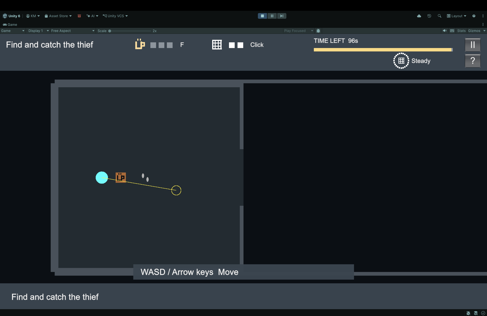
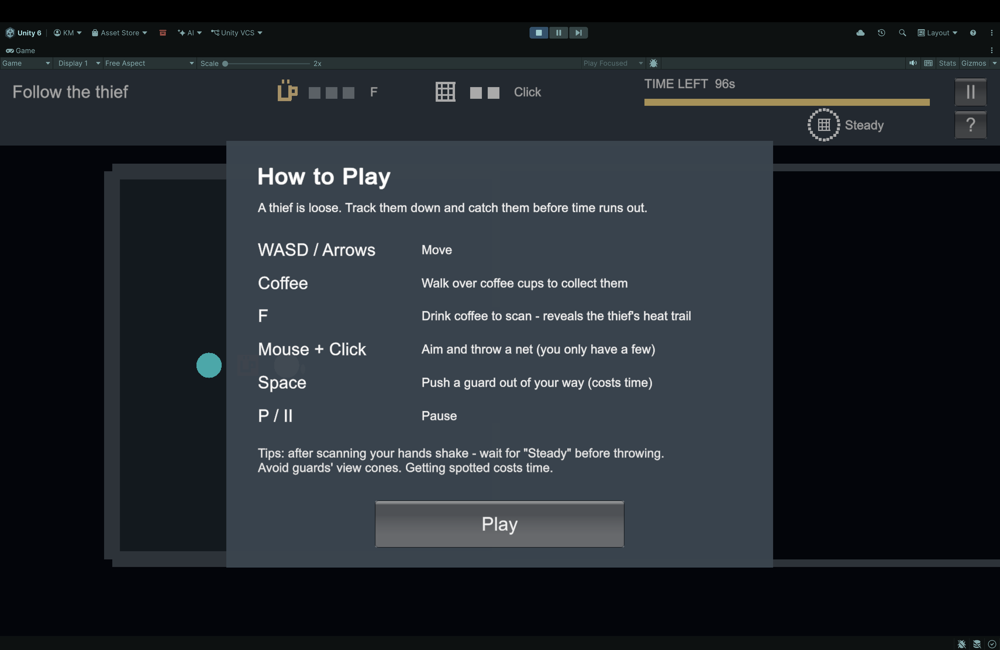
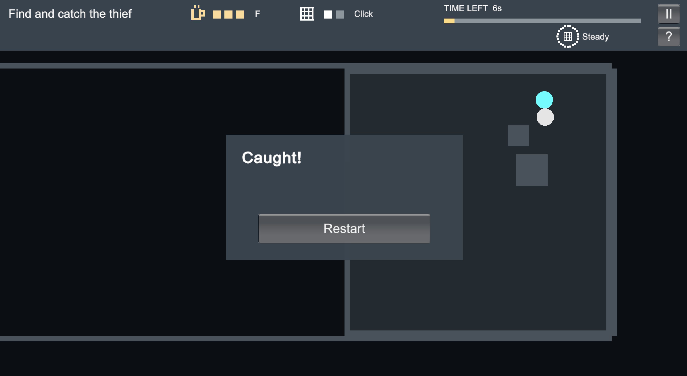

# Cold Brew Case: Alpha

A top-down 2D stealth-detective game. You track a hidden thief through a building by drinking coffee to see heat trails. Every scan leaves your hands shaking, so you have to choose between seeing more and aiming well.

**▶ Play in your browser:** https://rcodeborg2311.github.io/Cold_Brew_Case_Alpha/



## How to Play



A thief is on the loose. Watch where they run, track them down, and catch them with a net before the timer runs out.

Start from the **home screen**, pick a level, or open **How to Play** to see the controls first.

| Level | Description |
|---|---|
| **Level 1 – Courtyard to Hideout** | Beginner level that teaches the basics |
| **Level 2 – Two-floor pursuit** | Harder level with two floors and more to search |

Beat a level and its card on the home screen shows **Cleared** with your best time left.

| Control | Action |
|---|---|
| **WASD / Arrow keys** | Move |
| **F** | Drink coffee to scan the next room for the thief (press again to stop) |
| **Footprints** | Step on them to hear which way the thief went |
| **Mouse + Left Click** | Aim and throw a net |
| **Space** | Push a guard or crate (stuns a guard for 1s, costs time) |
| **P** or **II** | Pause |
| **?** | Show How to Play |

## Core Mechanics

- **Coffee heat-scan.** Walk over coffee cups to collect them. Drinking one gives about 10 seconds of heat vision, which reveals the thief's warm trail and hiding spot.
- **Shaky aim.** When a scan ends, your hands shake for a while. Throws are less accurate until the status reads **Steady**.
- **Footprints.** Stepping on footprint markers tells you which way the thief went. While the thief is in view, it also leaves fading red footprints behind it.
- **Limited nets.** You start with only 2 nets. A miss costs time and shows a pop-up with how many nets you have left. Running out of nets loses the round.
- **Guards.** Guards patrol with view cones. If one spots you, you're sent back to a checkpoint and lose time.
- **Push and noise.** Shoving a guard freezes them briefly, but it costs time and makes nearby guards turn toward you.
- **Escape timer.** Mistakes like getting spotted, pushing or missing a net drain the timer faster. When it hits zero, the thief escapes.

## Player Feedback & UX

- **First-time hints.** A short label appears over the first coffee cup (*"Press F to scan the next room"*) and the first footprint (*"Step here to hear the thief"*), and disappears once you've used each.
- **HUD captions.** The coffee and net counters at the top explain what they do.
- **Easy to tell apart.** The player is cyan with a white outline, the thief is red and carries a coffee bag, and guards are yellow.
- **Catch moment.** Netting the thief triggers a short slow-motion, a screen shake and a big **CAUGHT!**
- **Hint strip.** Control hints sit in a small strip at the bottom edge so they never cover the room.

**Twist:** in a typical shooter, aiming is the core skill. Here the information you need in order to aim (heat vision) directly makes your aim worse, so every throw is a trade-off between seeing and steadiness.



## Running the Project Locally

1. Install **Unity 6000.3.22f1** with Unity Hub.
2. Clone the repository:
   ```
   git clone https://github.com/rcodeborg2311/Cold_Brew_Case_Alpha.git
   ```
3. In Unity Hub, choose **Add → Add project from disk** and select the cloned folder.
4. Open **Assets/_Game/Scenes/Home** and press ▶. (You can also open **Level01** or **Level02** directly.)

## Project Structure

```
Assets/_Game/
  Scripts/   Gameplay code (player, thief, guards, HUD, coffee scan, nets,
             home screen, GameFeel.cs for catch effects and thief footprints)
  Editor/    Scene generation and validation tools
  Input/     GameInput.inputactions (Input System bindings)
  Data/      DefaultTuning.asset (speeds, timers, costs)
  Scenes/    Home.unity, Level01.unity, Level02.unity
docs/        WebGL build served by GitHub Pages
Tools/Analytics/  Playtest analytics scripts
```

To tweak game balance without touching any code, edit **Assets/_Game/Data/DefaultTuning.asset**. It holds values such as player and thief speed, scan and shake length, number of nets, and the escape time.

## Team

| Name | Role |
|---|---|
| _Name_ | Team Captain |
| _Name_ | Product Manager (Analytics) |
| _Name_ | Stenographer |

## External References

- Built with Unity 6 and the Unity Input System package.
- No external art assets are used; all visuals are graybox shapes.
- AI tools used during development: _list here, e.g. Claude for code assistance._
